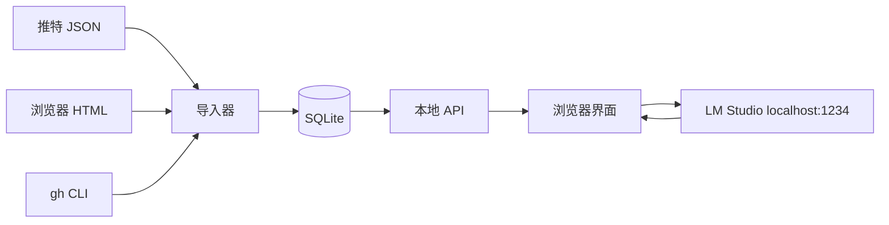

# TwitBookmark：个人书签工作台

日期：2026-11-02
状态：已批准，按本文构建

## 一句话

把推特书签、浏览器收藏、GitHub 星标收进一个本地网页应用：推特按日期消化，浏览器和 GitHub 当库来清理；键盘操作，AI 只出建议，数据全部留在本机。

## 为什么做

你保存书签的起点是「刷推特时看到一个可能用得上的东西，先存下来」。问题是存完就不会再看，过一阵忘了，彻底吃灰。浏览器收藏和 GitHub 星标也一样：数量越多，越记不起自己存过什么。

所以这不是一个更好看的收藏夹，而是一条能消化的流程：每天花不超过 10 分钟，把新内容过一遍；旧内容主动回看；库里的东西定期清理。AI 负责初筛，你负责判断。

## 目标

- 每天 10 分钟内处理完当天的新推特书签。
- 浏览器和 GitHub 的库可搜索、可批量清理、可打标签。
- 旧内容能主动回到眼前，不靠你记得。
- 所有数据本地存储；外网只碰三处：GitHub（gh）、本机 LM Studio、导入时下载推特缩略图。

## 非目标

- 不做多人协作、云同步、手机端。
- 不抓推特，不写回 Chrome，不在 GitHub 上取消 star。
- 不自动删除任何内容，不做全自动 AI 整理。

## 反目标

- 做成另一个需要管理的收件箱。
- 每天花超过 10 分钟。
- 误删内容找不回来。

## 使用流程

| 时机 | 做什么 |
| --- | --- |
| 首次 | 导入三类数据 → 在库里手动清理 → 用 LM Studio 做一次 AI 分类 |
| 每天 | 导入最新导出，打开推特流，过待处理的收藏，再看 2–3 条回看的旧收藏；勾选、改状态、标记要做的 |
| 偶尔 | 进库搜索、批量清理、重新同步 GitHub 星标 |

## 信息架构

一个应用，两个空间，外加设置页。

| 空间 | 放什么 | 主要操作 |
| --- | --- | --- |
| 推特流 `/` | 推特书签，按推文发布时间分组；下方是每日回看 | 逐条过、勾选、改状态、标记待办、打开原推 |
| 库 `/library` | 浏览器收藏和 GitHub 星标，按来源筛选 | 搜索、批量清理、打标签、改状态 |
| 设置 `/settings` | 导入、GitHub 同步、LM Studio、键位说明 | 配置 |



## 约束

- 本地单用户应用；服务器只绑定 `127.0.0.1`。
- 导入文件是不可信数据：只解析，不执行；不要把导入目录当作工作目录运行任何脚本。
- 不存储 GitHub token，使用本机已登录的 `gh`。
- 不向来源写回任何东西。
- 导入过程可重复执行：重复导入不产生重复条目，也不覆盖用户已经做的整理。

## 数据模型

SQLite 单文件，默认 `data/bookmarks.db`。条目统一成一张表，来源只作为字段，不为每个来源建一套。

```sql
CREATE TABLE items (
  id            TEXT PRIMARY KEY,
  source        TEXT NOT NULL CHECK (source IN ('twitter','browser','github')),
  title         TEXT NOT NULL,
  url           TEXT NOT NULL,
  created_at    TEXT,
  saved_at      TEXT NOT NULL,
  saved_source  TEXT CHECK (saved_source IN ('tweet_created','browser_added','first_seen')),
  imported_at   TEXT NOT NULL,
  status        TEXT NOT NULL DEFAULT 'inbox'
                CHECK (status IN ('inbox','later','done','reference')),
  read          INTEGER NOT NULL DEFAULT 0,
  is_todo       INTEGER NOT NULL DEFAULT 0,
  todo_done     INTEGER NOT NULL DEFAULT 0,
  metadata      TEXT NOT NULL DEFAULT '{}',
  ai_tags       TEXT NOT NULL DEFAULT '[]',
  ai_summary    TEXT,
  summary       TEXT,
  ai_state      TEXT NOT NULL DEFAULT 'none'
                CHECK (ai_state IN ('none','suggested','accepted')),
  last_surfaced_at TEXT,
  deleted_at    TEXT
);

CREATE TABLE tags (
  id    INTEGER PRIMARY KEY,
  name  TEXT NOT NULL UNIQUE
);

CREATE TABLE item_tags (
  item_id  TEXT NOT NULL REFERENCES items(id),
  tag_id   INTEGER NOT NULL REFERENCES tags(id),
  PRIMARY KEY (item_id, tag_id)
);

CREATE TABLE ai_jobs (
  id         TEXT PRIMARY KEY,
  kind       TEXT NOT NULL,
  status     TEXT NOT NULL,
  total      INTEGER NOT NULL,
  done       INTEGER NOT NULL DEFAULT 0,
  error      TEXT,
  created_at TEXT NOT NULL,
  updated_at TEXT NOT NULL
);

CREATE TABLE settings (
  key   TEXT PRIMARY KEY,
  value TEXT NOT NULL
);

CREATE VIRTUAL TABLE items_fts USING fts5(
  id UNINDEXED, title, text, summary
);
```

字段含义：

- `created_at`：来源本身的日期（推文发布时间、浏览器 ADD_DATE、仓库更新时间）。
- `saved_at`：时间线分组用的日期；`saved_source` 记录它来自推文发布时间、浏览器 ADD_DATE，还是第一次导入时间。
- `status`：收件箱 / 稍后 / 已消化 / 备查。每天处理的是「收件箱」。
- `read`：勾选，代表「我看过了」，和状态分开。
- `is_todo`：这条是要去做的事；只有它为真时才显示「做了」。
- `todo_done`：「做了」的勾。
- `ai_tags` / `ai_summary`：AI 的建议，未确认；确认后写入 `item_tags` 并置 `ai_state='accepted'`。
- `summary`：你编辑或确认后的摘要；重跑 AI 只更新 `ai_summary`，不覆盖它。
- `deleted_at`：软删除；进回收站，可恢复，不会自动清理。

AI 建议和你的确认分两层存，重跑模型或换模型不会覆盖你已整理好的标签和摘要。

### 补充字段约定（builder 可直接采用）

- `metadata` 是 JSON 文本：推特存作者、头像本地路径、媒体本地路径、互动数；浏览器存原文件夹路径（仅参考，不用于分组）；GitHub 存 `full_name`、`language`、`description`、`topics`、`stargazers_count`、`updated_at`。
- `items_fts` 的 `text` 存正文/描述，供全文搜索；用触发器或写入时同步维护。
- 时间统一存 ISO 8601 UTC 字符串；展示时按本地时区。

## 数据来源

### 推特

- 导入现有 JSON 数组；字段按当前文件（`id`、`created_at`、`full_text`、`media`、`screen_name`、`name`、`profile_image_url`、`url` 等）读取。
- 所有推特条目都用推文发布时间 `created_at` 作为 `saved_at`，历史和新导入一致，标记 `tweet_created`。
- 建议每天或每两三天导出一次；把 JSON 放进 `data/imports/` 会自动扫描，也可以在设置页手动选文件。
- 按推文 `id` 幂等：重复导入只更新正文和媒体，不重复插入，不改日期，不动用户整理结果。
- 应用不抓推特页面，也不做登录。
- 媒体缩略图在导入时下载到 `data/media/`，失败则显示占位图；不热链。
- ID 采用 `tw:<推文 id>`。
- 标题取正文前 80 个字符，过长截断加省略号；正文为空时用 `@作者`。

### 浏览器收藏

- 导入 Netscape 格式的 HTML 导出；只取链接标题、URL、ADD_DATE。
- `saved_at` 用 ADD_DATE；没有 ADD_DATE 时用导入时间。
- 不沿用原有文件夹结构。
- URL 规范化后去重：主机小写、去默认端口、去末尾斜杠、去掉 `utm_*` 和 `fbclid` 等跟踪参数。当前 1730 条会去重到约 1390 条。
- ID 用规范化 URL 的 SHA-1 前 12 位。
- 重复行保留 ADD_DATE 最早的一条；标题取第一条非空标题。
- 只读：应用里的删除只影响本地副本，不动 Chrome。

### GitHub 星标

- 用你已登录的 `gh` CLI 抓取，不在应用里存 token。
- 命令：`gh api 'user/starred?per_page=100' --paginate --slurp`，解析仓库对象。
- 取 `full_name`、`description`、`language`、`stargazers_count`、`html_url`、`topics`、`updated_at`。
- ID 用 `gh:owner/repo`；`saved_at` 用导入时间，标记 `first_seen`；再次同步只新增和更新，不删除你已经在工具里整理过的条目。
- 本机已确认：`gh` 2.96.0，已登录，`user/starred` 可读。
- 标题用 `full_name`；`created_at` 用 `updated_at`。

## 状态与标签

四个状态：收件箱、稍后、已消化、备查。勾选和状态是两件事；「做了」只对待办条目出现。

| 动作 | 效果 |
| --- | --- |
| 勾选 | `read=1`；在快速过一遍里会自动跳下一条 |
| 稍后 | `status='later'`；之后会进回看池 |
| 备查 | `status='reference'`；平时不打扰，靠搜索和回看找回 |
| 已消化 | `status='done'`；从待处理里消失 |
| 标为待办 | `is_todo=1`；出现「做了」勾选 |
| 做了 | `todo_done=1`；不改变状态 |
| 移除 | 软删除，进回收站；`u` 可撤销上一步，回收站里可恢复；不动来源 |

标签：用户可自建、改名、删除；删除标签只解除关联，不删除条目。条目可挂多个标签。

### 撤销与回收站

- `u` 撤销当前会话的最后一次条目变更（勾选、状态、标签、移除）；一次批量操作算一步。
- 撤销记录保存在内存中，刷新页面后清空（回收站仍然可用）。
- 移除的条目进回收站，在 `/library?deleted=1` 查看和恢复；不会自动清理。
- 10 秒提示只是快捷入口；之后仍可在回收站恢复。

## 核心界面

### 推特流

- 按 `saved_at`（推文发布时间）分组，新发布的在最上面；每张卡片显示作者、头像、正文、媒体缩略图、发布日期、状态、标签和勾选。
- 顶部显示「待处理 N 条」和「快速过一遍」。
- 「待处理」是收件箱（`inbox`）的全部条目，包括刚导入但发布时间较早的推文；新导入的直接进队列，不看发布日。
- 下方是「回看」：每天 2–3 条旧收藏，14 天内不重复；优先从没回看过的、稍后和备查里抽。
- 筛选：状态、标签、搜索。
- 条目详情可在侧栏或弹层展开：完整正文、媒体、来源链接、摘要、标签编辑。

### 快速过一遍

- 一次一条卡片，居中的阅读宽度，底部固定显示键位提示。
- `j` / `k` 上一条/下一条，`x` 勾选并下一条，`c` 已消化并下一条，`s` 稍后并下一条，`e` 备查并下一条，`d` 移除，`t` 打标签，`o` 打开原推，`Esc` 退出。
- 队列默认取收件箱；进入时快照当前顺序，处理中不因状态变化跳动。
- 所有移除都有撤销；处理完最后一条显示小结（勾选、已消化、稍后、备查、移除各多少条）。

### 库

- 默认表格：标题、来源图标、域名/仓库、标签、状态、日期。
- 来源筛选（浏览器 / GitHub）、标签筛选、全文搜索、状态筛选。
- 清理模式：一屏 10 条，`j` / `k` 移动，`Space` 多选，`a` 全选本屏，`d` 移除，`t` 打标签，`s` 稍后，`e` 备查，`c` 已消化，`Enter` 打开，`Esc` 退出。
- 批量操作只作用于选中项；没有选中时作用于光标所在项。
- 浏览器和 GitHub 共用这个空间，只靠来源筛选区分；不共用推特的日期时间线。
- 回收站视图：`/library?deleted=1`，可单条或批量恢复。

### 设置

- 导入：显示 `data/imports/` 最近扫描结果、手动导入按钮、上次导入统计。
- GitHub：同步按钮、上次同步时间、同步结果。
- LM Studio：地址、模型下拉（读 `/models`）、测试连接、taxonomy 提案编辑与确认、分类任务进度。
- 键位说明表。
- 数据位置说明与数据库备份提示。

## AI 分类

1. 设置里填 LM Studio 地址（默认 `http://localhost:1234/v1`），应用读取 `/models` 让你选一个模型。
2. 第一次：从三类来源各抽一些，凑 30–50 条，让模型提出 10–15 个中文标签和定义；你在界面里删改确认。
3. 确认后分批跑全量，每批 30 条；每条给 1–3 个标签和一句不超过 120 字的摘要。
4. 只发标题和 URL；GitHub 额外发仓库描述和语言；不抓网页正文。
5. 结果先存为「建议」；你在库里接受、修改或忽略。标签和摘要都可以改；你的修改永远覆盖 AI 的建议。
6. 任务可暂停、继续；LM Studio 没开时显示明确提示，不影响其他功能。

补充约定：

- 分类只使用已确认的 taxonomy 中的标签；模型给出体系外标签时丢弃，并在任务结果里计数。
- 只处理未删除条目；已经 `ai_state='accepted'` 的条目不重跑。
- `ai_jobs.status` 取值：`pending` / `running` / `paused` / `done` / `failed`。
- 建议在界面上可一键「全部接受」当前筛选结果，也可逐条接受。
- 先手动清理再分类：删掉不需要的，模型要标的条目更少，标签也更干净。

## 键位

| 键 | 作用 |
| --- | --- |
| `?` | 键位帮助 |
| `/` | 搜索 |
| `g t` / `g l` / `g s` | 去推特流 / 库 / 设置 |
| `j` / `k` | 下一条 / 上一条 |
| `x` | 勾选「看过」；库里是多选 |
| `c` | 已消化（归档） |
| `s` / `e` | 稍后 / 备查 |
| `d` | 移除（可撤销） |
| `t` | 打标签 |
| `o` / `Enter` | 打开原链接 |
| `u` | 撤销上一步 |
| `Esc` | 关闭弹层 / 退出模式 |

输入框获得焦点时不触发全局键位；`g` 前缀在 1 秒内等第二个键。

## 技术方案

- Node 24 + TypeScript，包管理用 pnpm 11。
- 后端 Fastify + better-sqlite3 + zod；前端 React + Vite + 手写 CSS 变量，不引组件库，保证键盘和焦点可控。
- 开发：`pnpm dev` 同时跑 Vite 和后端；使用：`pnpm build` 后 `pnpm start`，或双击 `start.bat`。
- 端口 `4317`；数据库 `data/bookmarks.db`；导入文件放 `data/imports/`；媒体放 `data/media/`。
- 测试：Vitest 做单元和 API 测试；Playwright 只覆盖键盘主流程的冒烟。
- 生产模式由 Fastify 提供构建后的前端静态文件；开发模式 Vite 代理 `/api` 到 4317。

```
TwitBookmark/
  package.json
  start.bat
  data/
    bookmarks.db
    imports/
    media/
  src/
    server/
      index.ts
      db.ts
      schema.sql
      importers/
        twitter.ts
        browser.ts
        github.ts
      routes/
        items.ts
        imports.ts
        ai.ts
        settings.ts
      ai/
        lmstudio.ts
        taxonomy.ts
        classify.ts
    web/
      main.tsx
      App.tsx
      routes/
        Twitter.tsx
        Library.tsx
        Settings.tsx
      components/
        ItemCard.tsx
        Timeline.tsx
        LibraryTable.tsx
        QuickPass.tsx
        TagPicker.tsx
        Keymap.tsx
      lib/
        api.ts
        keys.ts
        tokens.css
  tests/
    importers.test.ts
    items.test.ts
    ai.test.ts
```

## API

| 路由 | 作用 |
| --- | --- |
| `GET /api/items` | 列表；`source`、`status`、`tag`、`q`、`deleted`、`cursor`、`limit` 筛选 |
| `PATCH /api/items/:id` | 改 `status`、`read`、`is_todo`、`todo_done`、`summary` |
| `DELETE /api/items/:id` | 软删除 |
| `POST /api/items/bulk` | 批量改状态/勾选/删除 |
| `POST /api/items/:id/tags` | 确认标签（覆盖当前标签集合） |
| `POST /api/items/:id/restore` | 从回收站恢复 |
| `GET /api/tags` | 标签列表及计数 |
| `POST /api/tags` | 新建标签 |
| `PATCH /api/tags/:id` | 改名 |
| `DELETE /api/tags/:id` | 删除标签及关联 |
| `POST /api/import/twitter` | 导入推特 JSON |
| `POST /api/import/browser` | 导入浏览器 HTML |
| `GET /api/import/scan` | 扫描 `data/imports/` |
| `POST /api/sync/github` | 抓取 GitHub 星标 |
| `POST /api/ai/taxonomy` | 抽样并生成标签提案 |
| `POST /api/ai/classify` | 启动全量分类任务 |
| `GET /api/ai/jobs/:id` | 查询进度 |
| `POST /api/ai/jobs/:id/pause` | 暂停 |
| `POST /api/ai/jobs/:id/resume` | 继续 |
| `GET /api/review/daily` | 取每日回看条目 |
| `GET/PUT /api/settings` | 设置 |

约定：

- 错误返回 `{ error: string }` 与合适的 4xx/5xx。
- 列表返回 `{ items: Item[], nextCursor?: string }`，按 `saved_at` 倒序。
- `PATCH` 只更新传入字段；未知字段拒绝。
- 批量接口返回受影响条数。

## 视觉方向

「阅读桌」风格：暖白纸底色、近黑墨色文字、一个陶土色强调色；浅色和深色跟随系统。标题用 Segoe UI Variable，日期、键位和元数据用 Cascadia Code。少用卡片阴影，用细分隔线和留白分区；焦点框必须清楚。这是我这边的决定，之后可以单独做一版界面调整。

令牌草稿：

- 浅色：背景 `#F7F3EC`，纸面 `#FFFDF8`，文字 `#1F1B16`，次要文字 `#6B6257`，分隔线 `#E2DACB`，强调 `#B4552D`。
- 深色：背景 `#17140F`，纸面 `#211D17`，文字 `#EDE6D9`，次要文字 `#A79C8B`，分隔线 `#3A332A`，强调 `#D9784A`。
- 悬停/选中用强调色的低透明度底，不改变布局尺寸。
- 焦点：2px 强调色 outline，偏移 2px。

## 验收

- 能导入 48 条推特、1730 条浏览器链接（去重后约 1390 条）、676 条 GitHub 星标。
- 全天只用键盘就能完成：过新收藏、勾选、改状态、打标签、清理。
- LM Studio 分类能产出标签和摘要，建议可编辑、可忽略，你的修改不被覆盖。
- 删除可撤销；不写回 Chrome，不取消 GitHub star。
- 单元和 API 测试全绿。

## 先做什么

1. 搭项目骨架、SQLite 表、三个导入器。
2. 库的表格、清理模式和键盘。
3. 推特时间线、快速过一遍、状态。
4. 每日回看。
5. LM Studio 分类任务。
6. 设置、视觉打磨、测试。

## 已经定下的（用户说的）

- 推特书签按推文发布时间分组成时间线；所有推特条目统一用发布时间，不用第一次导入时间。
- 每条内容旁边有勾选项。
- 需要收件箱、稍后、已消化、备查四个固定状态；自定义分组用标签。
- 存在「有备无患」的备查类，平时不打扰。
- 标签加按标签筛选，作为找回方式之一。
- 每天在新收藏之外，回看 2–3 条旧收藏。
- 每天最多花 10 分钟。
- 先自己筛一遍、删掉不需要的，再用 AI 做初始分类。
- 分类走本地 LM Studio 的 OpenAI 兼容接口。
- GitHub 星标也纳入管理，很多已经不需要，想先清理。
- 只读导入，不回写；浏览器和 GitHub 都在工具里管理。
- 浏览器和 GitHub 共用「库」空间，推特保持独立的流。
- 形态是本地 Web 应用。
- 推特只导入现有 JSON，应用不自己抓取。
- 快速过一遍是一次一条卡片，Vim 键位。
- 勾选代表「我看过了」，和状态分开；「做了」只对待办条目出现。
- AI 先抽 30–50 条提标签，确认后再分批跑全量；AI 只出建议。

## 我替用户定的（可改）

- 技术栈：Node 24 + TypeScript、Fastify、better-sqlite3、React + Vite，pnpm。
- 端口 4317，数据库 `data/bookmarks.db`。
- 删除是软删除，进回收站；当前会话的变更可用 `u` 撤销，回收站不自动清理。
- 四个状态固定；自定义分组用标签。
- AI 摘要也分建议/确认两层。
- 推特媒体缩略图在导入时下载到本地。
- 导入保持现有导出工具：每天或每两三天导出一次；`data/imports/` 自动扫描，也可手动导入。
- 浏览器 URL 规范化并去重，忽略原文件夹结构。
- GitHub 同步只新增/更新，不删除已有整理结果。
- 每日回看 2–3 条，14 天内不重复，优先没回看过的稍后和备查。
- 视觉方向为「阅读桌」：暖白、墨黑、陶土色强调。
- 全文搜索用 SQLite FTS5。
- ID 约定：`tw:<tweet id>`、浏览器 URL SHA-1 前 12 位、`gh:owner/repo`。
- 浏览器重复链接保留 ADD_DATE 最早的一条。
- 生产环境由 Fastify 托管前端构建产物。

## 讨论用的 artifact

- 类型：document
- id：`bookmark-workbench`
- 路径：`.ryugi/artifacts/document/bookmark-workbench/doc.xml`
- 链接：http://localhost:27319/document/wRNvXCbCrO0ALhmkm0Lqu
- 决定了什么：本文全部产品决策，包括两个空间的信息架构、四个固定状态、AI 建议/确认两层、软删除与撤销、推特统一按发布时间分组、「待处理」按收件箱计数。用户在该文档上逐轮修改并最终确认「就按这个搭」。
